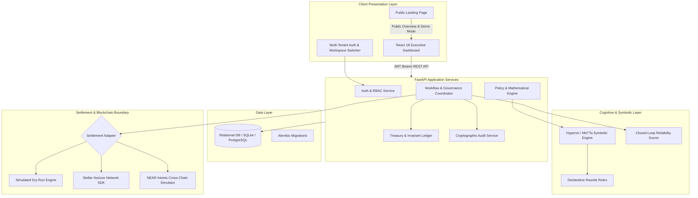

# FundGuard

**Autonomous, Human-Approved Payout & Treasury Governance Platform**

FundGuard is enterprise-grade treasury infrastructure for grant programs, accelerators, competitions, and ecosystem funds. It unites autonomous AI batch coordination with strict, non-negotiable cryptographic governance, deterministic mathematical capital preservation, and transparent blockchain settlement.

---

## Executive Summary

Managing large prize pools, accelerator disbursements, and ecosystem grant programs is fraught with operational risk:
- **Spreadsheet Errors & Overpayments:** Manual calculations risk catastrophic double-spends and rounding drift.
- **Rogue Transfer & Insider Threats:** Single-signature treasury wallets expose funds to unauthorized draining.
- **Regulatory & Tax Non-Compliance:** Disorganized payout spreadsheets make formal audits painful, slow, and expensive.
- **Unused Capital Leakage:** Programs lack formal, mathematically guaranteed formulas to safely reserve and carry forward unallocated capital when participant milestones fall short.

**FundGuard solves these challenges** by establishing an immutable, auditable bridge between executive intent and blockchain execution. It acts as an authoritative financial system of record:
- Autonomous agents draft proposals and verify eligibility rules.
- Human executives retain absolute, dual-control cryptographic sign-off.
- On-chain settlements on the Stellar network provide permanent, mathematically verifiable public proof.

---

## Core Value Proposition

### For Program Directors, Founders, and Grant Managers
- **100% Capital Preservation:** Automated proportional reserve formulas prevent over-disbursement. When fewer candidates meet milestone criteria than planned, unreleased funds automatically roll into an isolated, protected Carry-Forward Reserve.
- **Full Operational Isolation:** Multi-tenant workspace partitioning guarantees that budgets, recipient rosters, and financial audit trails never leak across programs or organizations.
- **Instant Stakeholder Trust:** Grantees, sponsors, and community members can independently verify disbursements on-chain via Stellar Horizon ledger records without exposing private internal metadata.
- **One-Click Audit Export:** Generate complete, cryptographically verified JSON and CSV ledgers for finance committees, external auditors, and tax authorities in seconds.

### For Chief Financial Officers and Compliance Leads
- **Dual-Control Governance:** Payout execution is physically impossible without an explicit human sign-off bound to the exact canonical SHA-256 fingerprint of the proposal. Any post-approval modification immediately invalidates the authorization.
- **Deterministic Zero-Drift Accounting:** All monetary values are handled in integer base units (Stellar stroops: 1 XLM = 10,000,000 stroops). Floating-point arithmetic is strictly prohibited in financial state transitions.
- **Closed-Loop Reliability Learning:** The platform tracks historical recipient wallet delivery reliability, flagging faulty or high-risk destinations before funds are committed.
- **Immutable SHA-256 Audit Chain:** Every action—from recipient onboarding to batch settlement—is sequentially hashed into an append-only cryptographic ledger.

---

## The 4-Step Operational Workflow

```
[ Step 1: Define Policy ]
   |  Configure total budget, target verified recipient threshold,
   |  and automated proportional reserve rules.
   v
[ Step 2: Register & Verify ]
   |  Onboard candidate recipients, validate ed25519 public keys,
   |  and record structured eligibility review decisions.
   v
[ Step 3: AI Proposes Batch ]
   |  Autonomous agent evaluates MeTTa symbolic reduction rules,
   |  computes proportional awards, and drafts a tamper-evident proposal.
   v
[ Step 4: Authorize & Settle ]
   |  Finance Director reviews canonical SHA-256 fingerprint;
   |  on-chain Stellar settlement delivers funds with Horizon receipts.
```

1. **Step 1 — Define Funding Policy:** Establish program budgets and formal release policies (e.g., proportional release formula: `min(1.0, Verified / Target) * Fund Pool`).
2. **Step 2 — Verify Recipients:** Grantees submit ed25519 Stellar wallet addresses (`GBZX...`). Reviewers verify milestone criteria and commit signed review notes.
3. **Step 3 — AI Drafts Payout Proposal:** The reasoning engine evaluates eligibility criteria, calculates base-unit awards, allocates unspent funds to carry-forward reserves, and generates a canonical SHA-256 fingerprint.
4. **Step 4 — Authorize & Settle On-Chain:** An authorized finance officer inspects the fingerprint and signs the approval. The settlement engine dispatches transactions across the Stellar network and verifies on-chain ledger confirmation.

---

## System Architecture



---

## Core Capabilities & Features

### 1. Multi-Tenant Workspace & Program Management
Create isolated program workspaces for grant cohorts, prize tracks, or regional funds. Each workspace maintains its own isolated budget, recipient directory, governance policies, and cryptographic audit log.

### 2. Proportional Capital Preservation Engine
When milestone standards are high and fewer candidates pass review than the target quota, FundGuard enforces the proportional release policy:
$$\text{Release Ratio} = \min\left(1.0, \frac{N_{\text{verified}}}{N_{\text{target}}}\right)$$
$$\text{Disbursed Capital} = \text{Fund Pool} \times \text{Release Ratio}$$
$$\text{Carry-Forward Reserve} = \text{Fund Pool} - \text{Disbursed Capital}$$
Unawarded capital is automatically safeguarded in the carry-forward balance rather than lost or overspent.

### 3. Dual-Control Cryptographic Governance
The system computes an immutable SHA-256 fingerprint over the canonicalized JSON payload of every proposed batch:
- No disbursement can execute without an explicit approval matching the batch fingerprint.
- If an operator attempts to alter a recipient address or modify an amount after review, the hash changes, and the execution engine refuses to fire.

### 4. Enterprise Stellar Settlement Engine
- **Official Stellar SDK Integration:** Built on `stellar-sdk` with strict StrKey public key validation.
- **Independent Horizon Verification:** Payouts are never marked confirmed upon simple network submission. The settlement engine queries the Horizon REST API independently to confirm the ledger inclusion, destination address, asset code, and exact stroop amount.
- **Fail-Safe Unresolved State:** In the event of a network timeout, transactions enter an `unresolved` state for operator reconciliation, preventing duplicate double-spends.

### 5. NEAR Intents Cross-Chain Routing Simulator
Simulate multichain cross-currency payouts. Calculate real-time dry quotes, conversion rates (XLM to NEAR), slippage estimates, and transaction fees without exposing live capital to cross-chain volatility.

### 6. Closed-Loop Reliability Learning
The platform includes an adaptive learning subsystem ("The Agent That Grows Up"):
- Incorporates human reviewer adjudication feedback on recipient deliverables.
- Dynamically updates recipient reliability scores between 0.0 and 1.0.
- Compiles custom MeTTa rewrite rules at runtime to streamline future program approvals.

### 7. Tamper-Evident SHA-256 Audit Trail
Every system action (registration, verification, draft, approval, disbursement, reconciliation) is appended to a sequentially chained SHA-256 hash log. A built-in validation engine scans the chain on demand to verify that zero historical entries have been modified or deleted.

---

## Mathematical Solvency Invariants

FundGuard continuously verifies three mathematical invariants across every workspace:

1. **Conservation of Budget:**
   $$\text{Total Program Budget} = \text{Settled Disbursements} + \text{Pending Authorizations} + \text{Remaining Available Balance}$$
2. **Reserve Conservation:**
   $$\text{Total Program Budget} = \text{Disbursed Funds} + \text{Proportional Policy Reserve}$$
3. **Execution Fingerprint Integrity:**
   $$\text{Approval Hash} = \text{SHA256}(\text{CanonicalBatchPayload})$$

---

## Technology Stack

| Layer | Component | Description |
|---|---|---|
| **Frontend** | React 18 & Vite | Ultra-fast single-page interface with clean, responsive Vanilla CSS |
| **Icons** | Lucide React | Professional enterprise iconography; zero unicode emojis |
| **Backend API** | Python 3.11+ & FastAPI | Async REST API with strict Pydantic v2 schema validation |
| **ORM & DB** | SQLAlchemy & Alembic | Relational schema with foreign-key constraints (SQLite/PostgreSQL) |
| **Logic Core** | Hyperon / MeTTa | Symbolic deductive reasoning engine with 45 declarative rewrite rules |
| **Blockchain** | Stellar Python SDK | Horizon RPC integration with integer stroop arithmetic |
| **Cross-Chain** | NEAR Intents Simulator | Dry quote calculator for multichain asset settlement |
| **Security** | SHA-256 & JWT | Cryptographic payload hashing, bcrypt auth, and RBAC authorization |

---

## API Reference Overview

The FastAPI backend exposes versioned, typed endpoints under `/api/v1`:

| Domain | Method & Endpoint | Description |
|---|---|---|
| **Auth** | `POST /api/v1/auth/register` | Register new organization user account |
| **Auth** | `POST /api/v1/auth/login` | Authenticate user and receive JWT access token |
| **Auth** | `GET /api/v1/auth/me` | Fetch active user profile, role, and organization |
| **Workspaces**| `GET /api/v1/competitions` | List all workspaces scoped to user organization |
| **Workspaces**| `POST /api/v1/competitions` | Create new isolated program workspace |
| **Workspaces**| `GET /api/v1/competitions/{id}`| Retrieve detailed workspace state and budget metrics |
| **Recipients** | `GET /api/v1/competitions/{id}/recipients` | List registered recipient teams and eligibility |
| **Recipients** | `POST /api/v1/competitions/{id}/recipients` | Register candidate recipient with ed25519 wallet |
| **Recipients** | `POST /api/v1/recipients/{id}/verify` | Verify recipient eligibility with review notes |
| **Recipients** | `GET /api/v1/competitions/{id}/recipients/template.csv` | Download sample CSV template with valid keys |
| **Recipients** | `POST /api/v1/competitions/{id}/recipients/bulk` | Bulk import recipients via JSON array |
| **Recipients** | `POST /api/v1/competitions/{id}/recipients/upload-csv` | Upload CSV file to bulk import recipients |
| **Policies** | `GET /api/v1/competitions/{id}/policies` | Retrieve active funding policies and versions |
| **Policies** | `POST /api/v1/policies/simulate` | Simulate proportional release award calculations |
| **Batches** | `POST /api/v1/competitions/{id}/batches` | Propose payout batch and compute SHA-256 hash |
| **Governance**| `POST /api/v1/batches/{id}/approve` | Cryptographically authorize batch fingerprint |
| **Settlement**| `POST /api/v1/batches/{id}/execute` | Execute settlement on Stellar Testnet or Simulator |
| **Treasury** | `GET /api/v1/competitions/{id}/treasury` | Inspect balance breakdown and solvency invariants |
| **Audit** | `GET /api/v1/competitions/{id}/audit` | Retrieve SHA-256 chained audit events |
| **Audit** | `GET /api/v1/audit/export` | Export verified audit ledger in JSON or CSV |
| **Learning** | `POST /api/v1/agent/learning/feedback` | Record human review feedback and update reliability |
| **Cross-Chain**| `POST /api/v1/near-intents/quote` | Request cross-chain swap rate simulation |

Interactive OpenAPI documentation is available at `http://127.0.0.1:8000/docs` when the backend is running.

---

## Quickstart & Installation

### Prerequisites
- Python 3.11+
- Node.js 20+ & npm 10+
- (Optional) Docker and Docker Compose

### Option A: Local Development Setup

#### 1. Backend Service
```bash
# Clone the repository
git clone https://github.com/Edwin420s/FundGuard.git
cd FundGuard/backend

# Create and activate virtual environment
python3 -m venv .venv
source .venv/bin/activate

# Install dependencies
pip install -r requirements.txt

# Configure environment
cp ../.env.example .env

# Run database migrations and launch server
uvicorn app.main:app --host 127.0.0.1 --port 8000 --reload
```
The backend API is now live at `http://127.0.0.1:8000`.

#### 2. Frontend Dashboard
```bash
# In a separate terminal
cd FundGuard/frontend

# Install dependencies
npm install

# Start Vite development server
npm run dev
```
Open your browser to `http://127.0.0.1:5173`.

---

### Option B: Docker Compose Deployment

To launch the full production-ready stack (React frontend served via Nginx, FastAPI backend, and PostgreSQL database):

```bash
cp .env.example .env
docker compose up --build -d
```

- Frontend: `http://localhost:5173`
- Backend API Docs: `http://localhost:8000/docs`

To shut down and reset the environment:
```bash
docker compose down -v
```

---

## Verification & Automated Test Suite

FundGuard includes comprehensive test coverage across both backend services and frontend components.

### Run Backend Tests (Pytest)
```bash
cd backend
python3 -m pytest tests/ -v
```
*Coverage includes:*
- Proportional award policy formulas and edge-case rounding.
- Canonical SHA-256 payload hashing and tamper-detection.
- Dual-control human approval enforcement and execution lockouts.
- MeTTa symbolic reduction rules and closed-loop reliability updates.
- Adversarial prompt injection defense and ineligible wallet refusal.

### Run Frontend Tests (Vitest)
```bash
cd frontend
npm test -- --run
```
*Coverage includes:*
- Public landing page rendering and visitor navigation.
- Sign-up, login, and tenant workspace data isolation.
- Form inputs, StrKey validation hints, and payout batch workflows.
- Treasury invariant breakdowns and audit trail displays.

### Build Production Frontend Bundle
```bash
cd frontend
npm run build
```

---

## Documentation Directory

Comprehensive architectural, security, and operational guides are maintained in the `docs/` directory:

| Document | Focus Area | Intended Audience |
|---|---|---|
| [`docs/PRD.md`](docs/PRD.md) | Product Requirements & Business Invariants | Founders, Product Leads, CFOs |
| [`docs/ARCHITECTURE.md`](docs/ARCHITECTURE.md) | System Boundaries, Components & Data Flows | System Architects, Engineers |
| [`docs/API_REFERENCE.md`](docs/API_REFERENCE.md) | Detailed REST API Endpoints & Payloads | Frontend & Integration Engineers |
| [`docs/DOMAIN_MODEL.md`](docs/DOMAIN_MODEL.md) | 15-Entity Relational Data Model & State Machines | Database Engineers, Backend Developers |
| [`docs/STELLAR_INTEGRATION.md`](docs/STELLAR_INTEGRATION.md) | Stellar Horizon RPC, StrKey & Safety Gates | Blockchain Engineers, Auditors |
| [`docs/SECURITY.md`](docs/SECURITY.md) | Threat Model, Trust Boundaries & Safety Policies | Security Auditors, Compliance Officers |
| [`docs/DEMO_SCRIPT.md`](docs/DEMO_SCRIPT.md) | Executive Product Walkthrough Script | Solution Architects, BizDev Leads |
| [`docs/OPERATIONS.md`](docs/OPERATIONS.md) | Deployment Topologies, Backups & Runbooks | DevOps & Site Reliability Engineers |
| [`docs/TEST_PLAN.md`](docs/TEST_PLAN.md) | Verification Matrix & Quality Acceptance Criteria | QA Engineers, Security Leads |
| [`docs/DECISIONS.md`](docs/DECISIONS.md) | Architectural Decision Records (ADRs) | Engineering Leadership |
| [`PROJECT_STATUS.md`](PROJECT_STATUS.md) | Verification Checklist & Release Milestones | All Stakeholders |
| [`AI_DISCLOSURE.md`](AI_DISCLOSURE.md) | Architectural Assurance & Governance Ethics | Compliance & External Auditors |

---

## Safety & Responsible Financial Operations

- **Simulated Settlement by Default:** FundGuard defaults to safe simulated execution or the Stellar public testnet.
- **Mainnet Disabled by Design:** Real mainnet fund transfers are permanently disabled in code until formal security audits, hardware custody signer integration, and legal approvals are finalized.
- **Zero Generative Guessing:** Payout amounts and wallet routing are strictly computed by deterministic symbolic MeTTa rules and integer math. No probabilistic LLM can modify financial state.

---

## License

This project is licensed under the Apache 2.0 License. See [`LICENSE`](LICENSE) for details.
