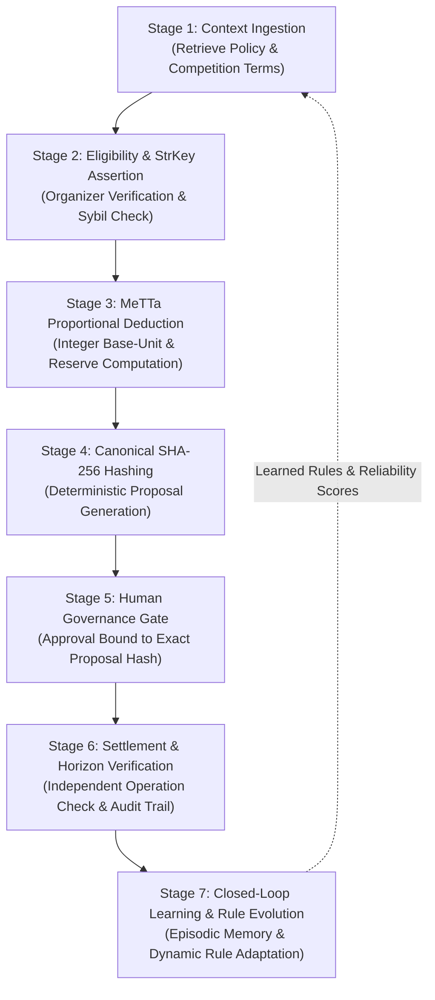

# Omega Cognitive Architecture — FundGuard

> *"Generative AI drafts proposals. MeTTa reasons and verifies invariants. Omega remembers, enforces safety policies, and learns from human decisions."*

## 1. Architectural Philosophy
In high-stakes hackathons, accelerator grants, and public prize distributions, LLM guessing or probabilistic hallucination is unacceptable:
- Floating-point discrepancies produce rounding losses or unbacked disbursements.
- Unconstrained autonomous agents risk unauthorized settlement execution or susceptibility to prompt injection.
- Split-difference compromises violate competition rules and donor intents.

Omega FundGuard addresses this through a six-stage stateful cognitive loop combining declarative MeTTa S-expression evaluation with strict human-in-the-loop governance and closed-loop feedback learning.

---

## 2. The 6-Stage Cognitive Loop

---

## 3. Subsystem Specifications

### `memory.metta`
- **Semantic Memory**: Domain constants, stroop base-unit conversions ($1\text{ XLM} = 10^7\text{ stroops}$), asset definitions.
- **Episodic Memory**: Comprehensive timeline of batch proposals, human review decisions, settlement receipts, and past reconciliation cases.
- **Belief State Register**: Current state of treasury obligations, reserved funds, paid amounts, and carry-forward balances.

### `learning.metta` ("The Agent That Grows Up")
- **Closed-Loop Feedback**: Absorbs human finance reviewer approvals, rejections, and dispute adjudications.
- **Recipient Reliability Scoring**: Dynamically adjusts recipient credibility weights ($0.0 \to 1.0$) based on verification history, past settlements, and dispute counts.
- **Dynamic Rule Registration**: Human administrators can register custom declarative MeTTa rewrite rules that dynamically modify future allocation weights, safety caps, or eligibility rules.

### `decisions.metta`
- **Safety Policy 01**: Hard payment lockout when batch proposal lacks human approval or hash mismatch occurs.
- **Safety Policy 02**: Absolute prohibition of live mainnet settlement execution.
- **Safety Policy 03**: Mandatory reconciliation before retry on any ambiguous Horizon submission.

### `skills.metta`
- Standardized typed signatures for the 11 allowlisted domain tools: `get_funding_policy`, `get_eligible_teams`, `calculate_allocation`, `validate_payout_batch`, `request_human_approval`, `get_approval_status`, `execute_approved_payout`, `verify_transaction`, `reconcile_payout`, `get_audit_history`, `get_simulated_near_quote`.

### `negotiation.metta`
- Quorum and multi-party separation-of-duties consensus protocols for high-value payout batches.
